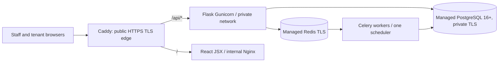

# Production deployment — controlled release packaging

**Status: packaging only; not a deployed or accepted business system.**

## Traffic flow



Only the Caddy container publishes ports. Backend and frontend containers are
private to the Compose network. This configuration intentionally requires
external managed PostgreSQL and Redis instead of hosting unaudited stateful
databases on the web node. Database migrations do NOT run on web startup.

## Prerequisites

1. Provision staging and production DNS with distinct hosts, managed private
   PostgreSQL 16+ (with PITR/backups and a dedicated non-owner/non-BYPASSRLS
   app role), private ACL/TLS Redis and an approved SMTP provider.
2. Copy ops/production.env.sample to .env.production and replace placeholders
   using an actual secrets manager. Keep the file mode 0600 and never commit
   it. Record owner access, disaster recovery and rotation procedures.
3. With separate DBA credentials, run `flask --app wsgi db upgrade` before
   starting the app and seed role-permission grants. Use the restricted app
   role for HTTP and workers. Verify FORCE RLS under that role.
4. In the prepared staging environment, run the security-preflight CLI,
   validate TLS, DNS, Cookie Secure, real client-IP propagation, DB/Redis
   health, email, role access and no HTTP direct backend exposure.
5. Start with:
   ```bash
   cp ops/production.env.sample .env.production
   # Replace all placeholder values first.
   export KATS_ENV_FILE=.env.production
   docker compose --env-file .env.production -f compose.production.yml config --quiet
   docker compose --env-file .env.production -f compose.production.yml up --build -d
   docker compose --env-file .env.production -f compose.production.yml ps
   curl --fail --show-error https://your-approved-host/readyz
   ```
6. Verify actual financial, privacy, document scan, in-person receipts,
   utility meters, rent notices, backups and rollback; only then move
   staging data and workflows toward approved production operation.

## Read-only release preflight

After schema migrations, run as the **restricted production API database
role**, using the same production environment as the API:

```sh
docker compose --env-file .env.production -f compose.production.yml \
  exec -T api python -m app.release_preflight
```

This checks production configuration, current Alembic schema revision,
non-superuser/non-BYPASSRLS DB role, FORCE RLS on private documents plus
core tenancy, finance, maintenance and notification tables, and Redis connectivity. Any failure blocks the release until fixed; the tool
does not write, migrate or reveal connection secrets. **PASS is not
business/go-live approval**. TLS, real backup restore, supplier approval,
mobile-money settlement, EFRIS, permissions, legal and data-protection
acceptance still require signed evidence.

The live site serves `/readyz` through Caddy/Nginx → Flask → PostgreSQL
and `/api/v1/*` through the same-origin edge. The local Vite dev server
mirrors both routes, with a separate `doctor` command to prove the bridge.

## Mandatory acceptance before taking real payments

- URA taxpayer-specific EFRIS and official receipts requirements; signed
  fiscal credit/cancellation integration with a verified adapter.
- Approved MTN/Airtel/bank rails when used and independently reconciled
  settlement, refunds and exceptions. Nothing is auto-enabled.
- Real S3 versioning and isolated ClamAV with quarantined files (if storage is
  enabled); do not bypass the scanner to recover previously unscanned files.
- All privileged accounts enrolled with MFA, protected recovery procedures,
  verified SMTP, DSAR/legal obligations and privacy counsel acceptance.
- Measured load p95/p99, horizontal/worker fault testing, backup restore,
  monitoring, independent penetration review, full mobile and accountant UAT.

There is no ISO 27001/OWASP certification or claim of a running system
without independent audited evidence. See docs/GO_LIVE_CHECKLIST.md.
